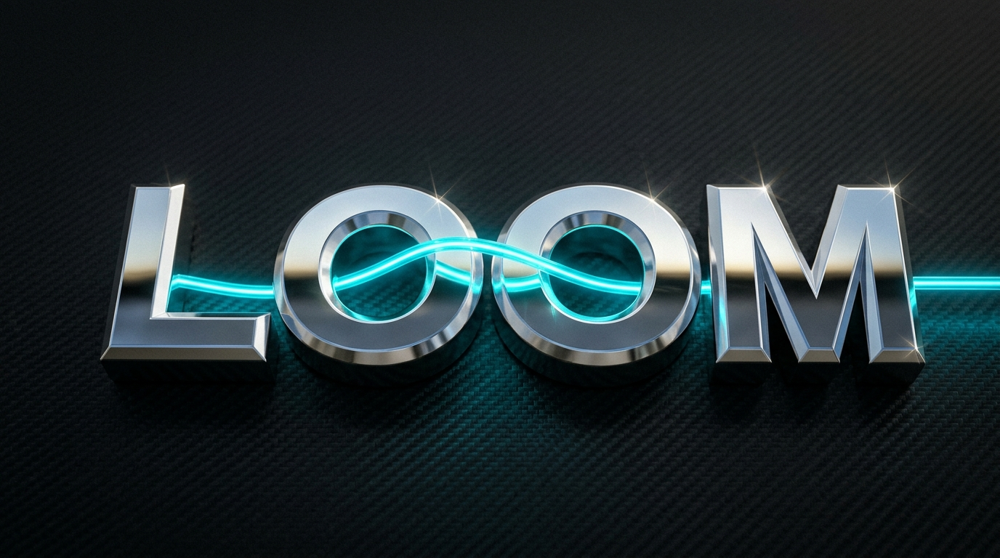

<p align="center">
  
</p>

# LOOM — Hi-Fi CyberDeck Video.js Skin

> A skeuomorphic Video.js 10 skin inspired by PowerDVD and Y2K hi-fi hardware. Features an authentic brushed platinum & chrome chassis, illuminated cyan VFD telemetry screen, optical laser seek rail, concentric machined jog wheel, visible focus outlines, and complete keyboard shortcuts.

**Live Production Demo:** [loom-skin.vercel.app](https://loom-skin.vercel.app)

---

## Key Features

- **Skeuomorphic Platinum Deck:** Heavy brushed metallic console chassis with chamfered specular highlights and 3D Billet Machined Chrome push buttons.
- **Backlit Cyan VFD Telemetry Console:** Full-width rackmount digital display (`flex: 1`) showing track title, chapter readout, audio bitstream, glowing timecode, and `16:9 LB`, `DTS`, `4K` hardware badges.
- **Optical Laser Seek Rail & Jog Wheel:** Electric cyan cyber-thread seek rail with polished chrome shuttle bead and concentric machined jog dial.
- **Vintage 90s VHS Settings OSD:** Scoped retro VCR/VHS on-screen display typography exclusively inside the Settings menu.
- **Bilateral Top HUD:** Synchronized dark cyan cockpit telemetry badges (`[• NASA COSMIC DAWN TRAILER | DOLBY DIGITAL • 4K]` and `[DISC: COSMIC_DAWN.VOB]`).
- **Complete Keyboard Navigation:** Unmissable `#00f0ff` focus rings, full keyboard shortcuts (<kbd>Space</kbd>/<kbd>K</kbd>, <kbd>M</kbd>, <kbd>F</kbd>, <kbd>C</kbd>, <kbd>I</kbd>, arrow keys), and reduced-motion compliance.

---

## Develop

```sh
npm run dev
```

- **Public Showcase** (`/`): The public-facing presentation of LOOM featuring the working player, design notes, and keyboard shortcuts deck.
- **Development Workbench** (`/workbench.html`): The interactive development workbench with the sidebar options panel (setting player width, aspect ratio, colour scheme, text direction, language, and playback options).
- **Player Preview** (`/preview.html`): The isolated player frame alone (e.g. `/preview.html#width=384&ratio=9:16`).

The preview plays NASA's Cosmic Dawn trailer from Mux with chapters; change the media in `apps/preview/src/frame/player`.

---

## Deploy

```sh
npm run deploy
```

It asks where to deploy the workbench: Vercel, Netlify, or Cloudflare Pages. Name one to skip the question, such as `npm run deploy vercel`.

To deploy on every push instead, put the project on GitHub and import it on Vercel or Netlify; `vercel.json` and `netlify.toml` already describe the build. The build uses relative URLs, so `dist/` also works on any static host, including in a subfolder.

---

## Project Structure

- `src/`: The core skin implementation.
  - `src/video/`: Video.js HTML components, skins, and dynamic VFD telemetry.
  - `src/styles/`: Theme tokens and shared styles (`scaffold.css`).
  - `src/video/skin.css`: Primary stylesheet for the skeuomorphic hardware deck.
- `apps/preview/`: The workbench and showcase applications.
  - `apps/preview/index.html`: Public showcase page.
  - `apps/preview/workbench.html`: Interactive developer workbench.
  - `apps/preview/public/`: Static assets including fonts, chapters, and the 3D metallic chrome logo suite.
- `vercel.json`: Deployment build and output configuration.
- `skin.json`: Video.js HTML skin metadata.

---

## Learn More

- [Video.js Documentation](https://videojs.org/docs/framework/html/guides/build-your-own-skin)
- [Video.js HTML Components](https://videojs.org/docs/framework/html/guides/ui-components)
